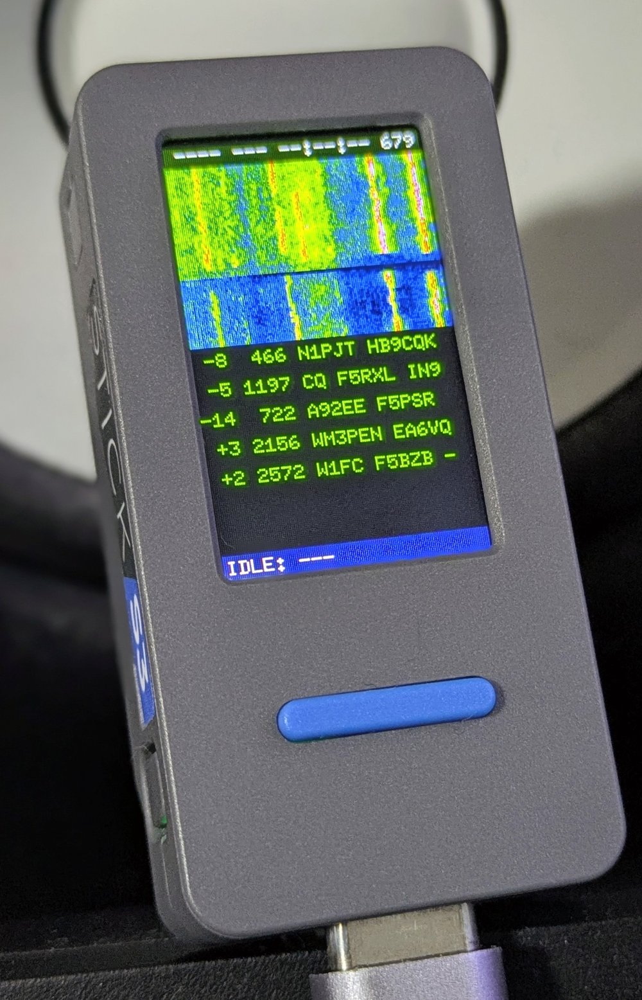

# mfsk-core

<p align="center">
  
</p>

<p align="center"><i><code>embedded-poc/m5stack-s3-app</code> を動かす M5StickS3。15 秒スロット1つから実際の FT8 を5局デコードし、QSO ステートマシンはオペレーターのコールサイン選択を待っています。<a href="https://github.com/jl1nie/mfsk-core/blob/main/docs/reference/MANUAL_M5STICKS3.ja.md">docs/reference/MANUAL_M5STICKS3.ja.md</a> を参照。</i></p>

[](https://github.com/jl1nie/mfsk-core/actions/workflows/ci.yml)
[](https://crates.io/crates/mfsk-core)
[](https://docs.rs/mfsk-core)
[](LICENSE)

English: [README.md](README.md)

## これは何か

`mfsk-core` は [WSJT-X](https://sourceforge.net/projects/wsjt/) のデジタルモード
— FT8、FT4、FST4、FST4W、WSPR、JT9、JT65、Q65(全10サブモード)、MSK144、WSJT-X 3.2 の JTTY —
を純 Rust で再実装したもので、デコード、エンコード、波形合成を備えます。すべてのアルゴリズムは
WSJT-X(Joe Taylor K1JT ら)から移植しており、WSJT-X が引き続きリファレンス実装です。
各ソースファイルには移植元の上流ファイルを明記しています。

これはライブラリで、もう一つの WSJT-X ではありません。目的は、Fortran/C/Qt のデスクトップ
アプリが入れない場所 — SDR につなぐ Windows / macOS のスキマー、ブラウザ(WASM)、Android/iOS、
`no_std` のマイコン — に WSJT-X 品質のデコーダーを届けることです。全 PR で WSJT-X 自身と
照合し(recall と誤検出を同時に確認)、リリース前には WSJT-X 自身のシミュレータとバイナリで
感度スイープを行います。

## これを使ったアプリケーション

いずれもサンプルアプリで、実際の信号でライブラリが動く様子を示すものです。受信専用で、
サポートの約束はありません。

| | 内容 | マニュアル |
|---|---|---|
| **mfsk-skimmer**(Windows、macOS) | 1本の IQ ストリームから FT8、FT4、FST4、WSPR、JT9、JT65、Q65、JTTY を多チャネル同時にデコード。入力は SpyServer(Airspy HF+、Airspy、RTL-SDR。既定)または rtl_tcp / rsp_tcp サーバー(実験的)。サーバー4台まで、バンドのローテーション、SDR# との共存、ウォーターフォール、受信したすべての記録と地図のデータベース、PSK Reporter への送信(既定はオフ)。インストーラ: [スキマーのリリース](https://github.com/jl1nie/mfsk-core/releases?q=skimmer)。 | [EN](https://github.com/jl1nie/mfsk-core/blob/main/docs/reference/MANUAL_SKIMMER.md) / [日本語](https://github.com/jl1nie/mfsk-core/blob/main/docs/reference/MANUAL_SKIMMER.ja.md) |
| **M5Stack CoreS3 受信機** | 主ハードウェアターゲット。無線機の USB Audio から FT8、FT4、JTTY を受信(IC-705 の 40 m で確認、1スロットあたり FT8 を 6〜8 局、+8〜−24 dB)、同じケーブルで CAT、無線機不要のデモも搭載。モードはタッチパネルで選択。 | [EN](https://github.com/jl1nie/mfsk-core/blob/main/docs/reference/MANUAL_M5STACK_CORES3.md) / [日本語](https://github.com/jl1nie/mfsk-core/blob/main/docs/reference/MANUAL_M5STACK_CORES3.ja.md) |
| **M5StickS3 FT8 コントローラー**(写真) | LCD UI、IC-705 への BLE CI-V、マイク入力、QSO ステートマシン。混雑バンドの FT8 録音をスロット終了後 1.19 秒でデコード。 | [EN](https://github.com/jl1nie/mfsk-core/blob/main/docs/reference/MANUAL_M5STICKS3.md) / [日本語](https://github.com/jl1nie/mfsk-core/blob/main/docs/reference/MANUAL_M5STICKS3.ja.md) |

スキマーは独自のバージョンとリリースタグ(`skimmer-vX.Y.Z`)を持ちます。開発者向けの説明は
[`apps/skimmer/README.md`](https://github.com/jl1nie/mfsk-core/blob/main/apps/skimmer/README.md) にあります。

## WSJT-X との比較

各モードで、WSJT-X `v3.2.0-rc1` 自身のデコーダーと同じタスク(同じ帯域、同じオペレーター情報、
同じ深さ)を同じシミュレーション録音で実行し、対応のある検定で判定します。「同等」は、
どの条件(チャネル、サブモード)でも偶然以上の差がないことを意味します。速度は両側とも
1スレッド、ファイルあたりの時間です(Ryzen 9 9900X)。

| モード | WSJT-X のデコーダー | WSJT-X に対する感度 | WSJT-X に対する速度 |
|---|---|---|---|
| FT8 | `jt9 -8 -d 3` | 同等(4条件) | 4.8〜5.0 倍高速 |
| FT4 | `jt9 -5 -d 3` | 同等(4条件) | 3.3〜6.7 倍高速 |
| FST4 | `jt9 -7 -d 3` | 同等、20条件中1で上回る | 4.3〜5.0 倍高速 |
| FST4W | `jt9 -W -d 3`(`v3.3.0-beta1`) | 同等(8条件) | 3.3〜3.6 倍高速 |
| Q65 | `jt9 -3 -d 1` | 同等、20条件中9で上回る | 3.4〜3.8 倍高速 |
| JT9 | `jt9 -9 -d 3` | 同等 | 5.3 倍高速 |
| JTTY | `rjtty` | 完全一致: 360 試行すべて一致 | 7〜9 倍高速 |
| WSPR | `wsprd` | 同等 | 0.8〜4.2 倍(デコード限界付近では遅い。10 ファイル) |
| JT65 | `jt9 -6 -d 3` | **劣る**(既知。レガシーのため追わない) | 4〜20 倍高速 |

実際の受信録音 — ft8_lib に同梱の 22 本 — では、FT8 デコーダーは `jt9 -8 -d 3` が見つける
401 メッセージをすべて見つけ、1ファイルあたり 1.29 秒(`jt9` は 3.57 秒)です(0.15.1)。
MSK144 はまだ表にありません。以前に本物の `jt9` と比べたときは 28 の SNR セル中 25 で一致しました。

感度は 2026-10-10、速度は 2026-10-01〜2026-10-11 の計測で、FT8 の速度は 0.15.1(FT8 が約 17 %
遅くなった)より前のものです。件数と方法:
[`docs/notes/UPSTREAM_EVALUATION.md`](https://github.com/jl1nie/mfsk-core/blob/main/docs/notes/UPSTREAM_EVALUATION.md)、
[`docs/notes/FT8_REAL_VS_JT9.md`](https://github.com/jl1nie/mfsk-core/blob/main/docs/notes/FT8_REAL_VS_JT9.md)、
プロトコルごとの詳細は
[`docs/notes/BENCHMARKS.md`](https://github.com/jl1nie/mfsk-core/blob/main/docs/notes/BENCHMARKS.md)。

## 対応プロトコル

| プロトコル | スロット | FEC | メッセージ | 同期 | feature |
|---|---|---|---|---|---|
| FT8 | 15 s | LDPC(174, 91) + CRC-14 | 77 bit | 3 × Costas-7 | `ft8` |
| FT4 | 7.5 s | LDPC(174, 91) + CRC-14 | 77 bit | 4 × Costas-4 | `ft4` |
| FST4-15/30/60A/120/300/900/1800 | 15〜1800 s | LDPC(240, 101) + CRC-24 | 77 bit | 5 × Costas-8 | `fst4` |
| FST4W-120/300/900/1800 | 120〜1800 s | LDPC(240, 74) + CRC-24 | 50 bit | 5 × Costas-8 | `fst4w` |
| WSPR | 120 s | 畳み込み r=½ K=32 + Fano | 50 bit | シンボルごとの LSB | `wspr` |
| JT9 | 60 s | 畳み込み r=½ K=32 + Fano | 72 bit | 分散配置 16 スロット | `jt9` |
| JT65 | 60 s | Reed-Solomon(63, 12) GF(2⁶) | 72 bit | 分散配置 63 スロット | `jt65` |
| Q65-15A/30A、60A‥E、120D/120E、300A | 15〜300 s | QRA(15, 65) GF(2⁶) + CRC-12 | 77 bit | 分散配置 22 スロット | `q65` |
| MSK144 | 15 s | LDPC(128, 90) + CRC-13 | 77 bit | 流星バーストの走査 | `msk144` |
| JTTY | なし(1.888 s のフレーム) | テイルバイティング畳み込み r=½ K=10 + CRC-12 | 34 bit / フレーム | 13 シンボル + list-WAVA | `jtty` |

26 のスロットモードは1つの汎用デコーダー `Decoder<P>` でデコードします。MSK144(流星散乱
バーストの連続位相 MSK)と JTTY(スロットがなく、送信側の好きなときにフレームが始まる)は
設計上、専用の受信器を持ちます。`uvpacket` は同じ部品で組んだ、WSJT-X 外の実験的なパケット
モードです([`UVPACKET.ja.md`](https://github.com/jl1nie/mfsk-core/blob/main/docs/reference/UVPACKET.ja.md))。

## クイックスタート

```toml
# Cargo.toml
[dependencies]
mfsk-core = { version = "0.15", features = ["ft8", "ft4"] }
```

変更はマージされ次第 `main` に入り、crates.io へのリリースは2週間ごとです。リリース前の修正が
必要なら、リポジトリに依存してください:
`mfsk-core = { git = "https://github.com/jl1nie/mfsk-core", branch = "main", features = ["ft8"] }`。

FT8 のフレームを合成して、デコードし直す例:

```rust
use mfsk_core::prelude::*;

// 1. メッセージを符号化して 12 kHz PCM を合成し、15 秒スロットに置く。
let tx = encode(Mode::Ft8, "CQ JA1ABC PM95").unwrap();
let frame = tx.synthesize_i16(&TxAudio::new(12_000, /* freq */ 1500.0), /* amp */ 20_000);

let mut audio = vec![0i16; 180_000]; // 15 s @ 12 kHz
let start = (0.5 * 12_000.0) as usize;
let end = (start + frame.len()).min(audio.len());
audio[start..end].copy_from_slice(&frame[..end - start]);

// 2. デコードし直す。WSJT-X がモードごとに `jt9 -s` を1つ動かすのと同じく、デコーダーは
//    モードごとに1つ: コールサイン表、a7、平均を周期をまたいで保持する。
//    `with_defaults()` は GUI のパラメータブロック。
let mut decoder = AnyDecoder::with_defaults(Mode::Ft8);
let slot = decoder.decode(&SlotInput::i16(&audio));
assert_eq!(slot.rows[0].decoded.text, "CQ JA1ABC PM95");
for row in &slot.rows {
    let d = &row.decoded;
    println!("{:7.1} Hz  dt={:+.2} s  SNR={:+.0} dB  {}", d.freq_hz, d.dt_sec, d.snr_db, d.text);
}
```

`AnyDecoder` は実行時にモードを選び、`Decoder::<Ft8>` は同じデコーダーをコンパイル時に型で
決めたもので、モード固有の結果を返します。デコーダーは `DecodeParams` — WSJT-X の周期ごとの
パラメータブロック(深さ、AP、帯域、Rx/Tx 周波数、局と QSO)— から作り、各周期を `SlotInput`
として渡します。ライブラリ独自のオプションはモードごとに型の決まった `Extras` で、そのモードに
ないオプションはコンパイルが通りません。[docs.rs](https://docs.rs/mfsk-core) の各プロトコル
モジュールに、オプションの説明と例があります:

- [`ft8`](https://docs.rs/mfsk-core/latest/mfsk_core/ft8/) — a7 リストデコーダー、スナイパー(ルーフィングフィルタ)モード、AP ヒント、デコード戦略
- [`ft4`](https://docs.rs/mfsk-core/latest/mfsk_core/ft4/)、[`fst4`](https://docs.rs/mfsk-core/latest/mfsk_core/fst4/)(ノイズブランカー)、[`fst4w`](https://docs.rs/mfsk-core/latest/mfsk_core/fst4w/)、[`wspr`](https://docs.rs/mfsk-core/latest/mfsk_core/wspr/)、[`jt9`](https://docs.rs/mfsk-core/latest/mfsk_core/jt9/)、[`jt65`](https://docs.rs/mfsk-core/latest/mfsk_core/jt65/)(Chase デコーダー)
- [`q65`](https://docs.rs/mfsk-core/latest/mfsk_core/q65/) — 平均化、AP、マイクロ波 EME 向けの高速フェージング指標、WSJT-X 3.2 の Pileup と Max Drift
- [`jtty`](https://docs.rs/mfsk-core/latest/mfsk_core/jtty/) — ストリーミング受信器(音声を分割して入力し、メッセージの更新をコールバックで受け取る)と送信
- [`msk144`](https://docs.rs/mfsk-core/latest/mfsk_core/msk144/) — `decode::decode_slot`
- [`iq`](https://docs.rs/mfsk-core/latest/mfsk_core/iq/) — SDR の広帯域 IQ 入力: 1つのダイヤル周波数を選択度 120 dB の 12 kHz 音声として取り出す、または N チャネルを UTC でデコードし各行に絶対周波数を付ける。多相フィルタバンクが前段を共有(2.4 MS/s ストリームの 128 チャネルで 1 コアの 41 %)

API ガイドの全体は [`docs/reference/LIBRARY.ja.md`](https://github.com/jl1nie/mfsk-core/blob/main/docs/reference/LIBRARY.ja.md) です。

## 機能フラグ

| feature | 既定 | 有効になるもの |
|---|---|---|
| `ft8`、`ft4` | ✓ | FT8 / FT4 |
| `fst4`、`fst4w`、`wspr`、`jt9`、`jt65`、`q65`、`msk144`、`jtty` | | そのプロトコル(`fst4w` は `fst4` を含む。MSK144 と JTTY の受信器には FFT バックエンドが必要) |
| `uvpacket` | | 実験的なパケットモード |
| `packet-bytes` | | 生バイト列のメッセージコーデック |
| `serde` | | `Decoded` と `ProtocolId` の `Serialize` / `Deserialize` |
| `parallel` | ✓ | Rayon による候補の並列処理 |
| `fft-rustfft` | ✓ | ホスト用 FFT バックエンド(`rustfft`、`std` が必要) |
| `fft-extern` | | 呼び出し側が用意する FFT(esp-dsp、CMSIS-DSP など)、`no_std` 向け |
| `fixed-point` | | 組み込み用の整数パイプライン([`EMBEDDED.ja.md`](https://github.com/jl1nie/mfsk-core/blob/main/docs/reference/EMBEDDED.ja.md)) |
| `full` | | 全プロトコル、`uvpacket`、`packet-bytes`、`serde`、`parallel`、`fft-rustfft` |

## プラットフォーム

- **デスクトップ / サーバー**: 既定の feature のまま。
- **WebAssembly**: `wasm32-unknown-unknown` 向けにビルドできます。利用側プロジェクトの
  `.cargo/config.toml` でそのターゲットに `rustflags = ["-C", "target-feature=+simd128"]` を
  設定してください。設定しないとデコーダーと FFT がスカラーで動きます(FT8 で約 20 % 遅い、
  [`BENCHMARKS.md`](https://github.com/jl1nie/mfsk-core/blob/main/docs/notes/BENCHMARKS.md))。
- **組み込み(`no_std + alloc`)**: `default-features = false, features = ["alloc", "ft8",
  "fft-extern"]` と独自の FFT。M5Stack のボードが使う整数パスは `fixed-point`。
  [`EMBEDDED.md`](https://github.com/jl1nie/mfsk-core/blob/main/docs/reference/EMBEDDED.md)
  ([日本語](https://github.com/jl1nie/mfsk-core/blob/main/docs/reference/EMBEDDED.ja.md))。
- **C / C++ / Kotlin / Swift**: `mfsk-ffi` が `libmfsk` と `mfsk.h` をビルドします。全モードを
  扱う不透明ハンドルの C ABI です。`bindings/kotlin/`(JNI)と `bindings/swift/`(SwiftPM)が
  これを包み、CI が両方をビルドしてテストします。各リリースに Linux、Windows、Android、iOS 向けの
  ビルド済みライブラリを添付します。
  [`BINDINGS.md`](https://github.com/jl1nie/mfsk-core/blob/main/docs/reference/BINDINGS.md)
  ([日本語](https://github.com/jl1nie/mfsk-core/blob/main/docs/reference/BINDINGS.ja.md))。

## 設計の概要

スロットモードはすべて同じパイプラインで動き、違うのは各段に差し込む定数(トーン数、同期
パターン、FEC 符号、メッセージ配置)だけです:

```text
audio → spectrogram → candidate search → fine sync → tone → LLR → FEC → message unpack
```

このパイプラインは `engine` にあり、各モードがゼロサイズ型に実装する `Protocol` トレイトに
対してジェネリックなので、モードごとに単相化されます。ホットパスに動的ディスパッチはなく、
サブモードの追加はトレイト実装で済み、リファクタリングを伴いません。なぜこう作ったか:
[`docs/notes/DESIGN_RATIONALE.md`](https://github.com/jl1nie/mfsk-core/blob/main/docs/notes/DESIGN_RATIONALE.md)。
どう作ったか: [`LIBRARY.ja.md`](https://github.com/jl1nie/mfsk-core/blob/main/docs/reference/LIBRARY.ja.md)
と [`CORE_INTERNALS.md`](https://github.com/jl1nie/mfsk-core/blob/main/docs/notes/CORE_INTERNALS.md)。

## ドキュメント

| | English | 日本語 |
|---|---|---|
| ライブラリ API | [LIBRARY.md](https://github.com/jl1nie/mfsk-core/blob/main/docs/reference/LIBRARY.md) | [LIBRARY.ja.md](https://github.com/jl1nie/mfsk-core/blob/main/docs/reference/LIBRARY.ja.md) |
| 見つかった順にデコード結果を渡す | [STREAMING.md](https://github.com/jl1nie/mfsk-core/blob/main/docs/reference/STREAMING.md) | [STREAMING.ja.md](https://github.com/jl1nie/mfsk-core/blob/main/docs/reference/STREAMING.ja.md) |
| C ABI、Kotlin、Swift | [BINDINGS.md](https://github.com/jl1nie/mfsk-core/blob/main/docs/reference/BINDINGS.md) | [BINDINGS.ja.md](https://github.com/jl1nie/mfsk-core/blob/main/docs/reference/BINDINGS.ja.md) |
| 組み込み、`no_std`、固定小数点 | [EMBEDDED.md](https://github.com/jl1nie/mfsk-core/blob/main/docs/reference/EMBEDDED.md) | [EMBEDDED.ja.md](https://github.com/jl1nie/mfsk-core/blob/main/docs/reference/EMBEDDED.ja.md) |
| スキマーのマニュアル | [MANUAL_SKIMMER.md](https://github.com/jl1nie/mfsk-core/blob/main/docs/reference/MANUAL_SKIMMER.md) | [MANUAL_SKIMMER.ja.md](https://github.com/jl1nie/mfsk-core/blob/main/docs/reference/MANUAL_SKIMMER.ja.md) |
| CoreS3 受信機のマニュアル | [MANUAL_M5STACK_CORES3.md](https://github.com/jl1nie/mfsk-core/blob/main/docs/reference/MANUAL_M5STACK_CORES3.md) | [MANUAL_M5STACK_CORES3.ja.md](https://github.com/jl1nie/mfsk-core/blob/main/docs/reference/MANUAL_M5STACK_CORES3.ja.md) |
| M5StickS3 のマニュアル | [MANUAL_M5STICKS3.md](https://github.com/jl1nie/mfsk-core/blob/main/docs/reference/MANUAL_M5STICKS3.md) | [MANUAL_M5STICKS3.ja.md](https://github.com/jl1nie/mfsk-core/blob/main/docs/reference/MANUAL_M5STICKS3.ja.md) |
| ベンチマーク | [BENCHMARKS.md](https://github.com/jl1nie/mfsk-core/blob/main/docs/notes/BENCHMARKS.md) | |
| リリースごとの変更 | [CHANGELOG.md](https://github.com/jl1nie/mfsk-core/blob/main/CHANGELOG.md) | |

## 状況

公開中のバージョンは上の crates.io バッジのとおりです。API は固定していません: 破壊的変更は
マイナーバージョン(`0.x`)、プロトコルの追加だけならパッチで上げます。リリースは2週間ごとで、
`CHANGELOG.md` の先頭がそれ以降にマージされた内容です。残作業:
[`docs/notes/ROADMAP.md`](https://github.com/jl1nie/mfsk-core/blob/main/docs/notes/ROADMAP.md)。

## コントリビューション

プルリクエストを歓迎します。クローン後に一度 `bash scripts/install-hooks.sh` を実行してください。
デコーダーや FEC の変更は、移植元の WSJT-X ソースとの対応がレビューで見えるよう、先に Issue を
立ててください。ルール、テストの階層、プロトコルの追加方法:
[`CONTRIBUTING.md`](https://github.com/jl1nie/mfsk-core/blob/main/CONTRIBUTING.md)。

## ライセンスと帰属

**GPL-3.0-only**。WSJT-X が「or later」なしで「バージョン 3」としているのに合わせています
([LICENSE](LICENSE)。0.13.0 までは `GPL-3.0-or-later` として公開、#569)。すべての
アルゴリズムは Joe Taylor K1JT らによる [WSJT-X](https://sourceforge.net/projects/wsjt/) に
由来します。このクレートは、それらのデコーダーが動く場所を広げるもので、WSJT-X を置き換える
ものではなく、WSJT-X が引き続きリファレンスです。
