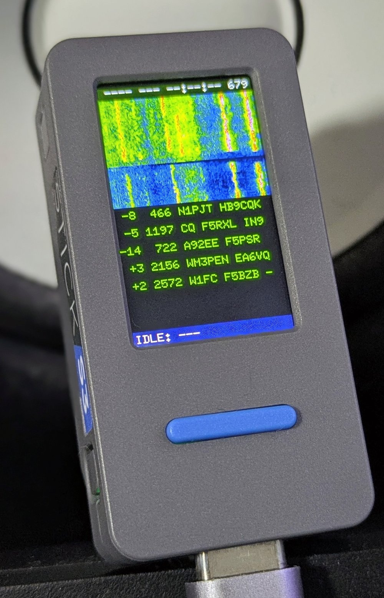

# mfsk-core

<p align="center">
  
</p>

<p align="center"><i>M5StickS3 running <code>embedded-poc/m5stack-s3-app</code> — five real on-air FT8 decodes from a single 15 s slot, QSO FSM idle waiting for the operator to pick a callsign. See <a href="https://github.com/jl1nie/mfsk-core/blob/main/docs/reference/MANUAL_M5STICKS3.md">docs/reference/MANUAL_M5STICKS3.md</a>.</i></p>

[](https://github.com/jl1nie/mfsk-core/actions/workflows/ci.yml)
[](https://crates.io/crates/mfsk-core)
[](https://docs.rs/mfsk-core)
[](LICENSE)

日本語: [README.ja.md](README.ja.md)

## What is this?

`mfsk-core` is a pure-Rust re-implementation of the
[WSJT-X](https://sourceforge.net/projects/wsjt/) digital modes — FT8, FT4,
FST4, FST4W, WSPR, JT9, JT65, Q65 (all ten sub-modes), MSK144 and WSJT-X
3.2's JTTY — with decoding, encoding and waveform synthesis. Every algorithm
is ported from WSJT-X (Joe Taylor K1JT and collaborators), which remains the
reference implementation; each source file names the upstream file it ports.

It is a library, not another WSJT-X: the aim is to put WSJT-X-quality
decoders where a Fortran/C/Qt desktop application cannot go — a Windows or
macOS skimmer on an SDR, a browser (WASM), Android/iOS, and `no_std`
microcontrollers. It is checked against WSJT-X itself on every pull request
(recall and false decodes together) and, before releases, in sensitivity
sweeps against WSJT-X's own simulators and binaries.

## Applications built on it

These are sample applications: they show the library at work on real
signals. They receive only and come with no support promise.

| | what it is | manual |
|---|---|---|
| **mfsk-skimmer** (Windows, macOS) | Decodes FT8, FT4, FST4, WSPR, JT9, JT65, Q65 and JTTY on many channels at once from one IQ stream, read from a SpyServer (Airspy HF+, Airspy, RTL-SDR; the default) or an rtl_tcp / rsp_tcp server (experimental); up to four servers, band rotation, coexists with SDR#, waterfall, a database of everything heard with a map, optional PSK Reporter upload (off by default). Installers: [skimmer releases](https://github.com/jl1nie/mfsk-core/releases?q=skimmer). | [EN](https://github.com/jl1nie/mfsk-core/blob/main/docs/reference/MANUAL_SKIMMER.md) / [日本語](https://github.com/jl1nie/mfsk-core/blob/main/docs/reference/MANUAL_SKIMMER.ja.md) |
| **M5Stack CoreS3 receiver** | The main hardware target: FT8, FT4 and JTTY from a transceiver's USB Audio (verified with an IC-705 on 40 m, six to eight FT8 stations per slot from +8 to −24 dB), CAT over the same cable, plus a radio-free demo; mode chosen on the touch panel. | [EN](https://github.com/jl1nie/mfsk-core/blob/main/docs/reference/MANUAL_M5STACK_CORES3.md) / [日本語](https://github.com/jl1nie/mfsk-core/blob/main/docs/reference/MANUAL_M5STACK_CORES3.ja.md) |
| **M5StickS3 FT8 controller** (pictured) | LCD UI, BLE CI-V to an IC-705, microphone capture, a QSO state machine. Decodes a busy-band FT8 recording in 1.19 s after the slot ends. | [EN](https://github.com/jl1nie/mfsk-core/blob/main/docs/reference/MANUAL_M5STICKS3.md) / [日本語](https://github.com/jl1nie/mfsk-core/blob/main/docs/reference/MANUAL_M5STICKS3.ja.md) |

The skimmer has its own version and release tags (`skimmer-vX.Y.Z`); its
developer notes are in [`apps/skimmer/README.md`](https://github.com/jl1nie/mfsk-core/blob/main/apps/skimmer/README.md).

## How it compares with WSJT-X

Each mode runs the job WSJT-X `v3.2.0-rc1`'s own decoder runs (same band,
same operator knowledge, same depth) on the same simulated recordings, and a
paired test decides. "The same" means no condition (channel, sub-mode)
differs by more than chance. Speed is one thread on each side, per file
(Ryzen 9 9900X).

| mode | WSJT-X decoder | sensitivity against WSJT-X | speed against WSJT-X |
|---|---|---|---|
| FT8 | `jt9 -8 -d 3` | the same (4 conditions) | 4.8–5.0× faster |
| FT4 | `jt9 -5 -d 3` | the same (4 conditions) | 3.3–6.7× faster |
| FST4 | `jt9 -7 -d 3` | the same; better in 1 of 20 conditions | 4.3–5.0× faster |
| FST4W | `jt9 -W -d 3` (`v3.3.0-beta1`) | the same (8 conditions) | 3.3–3.6× faster |
| Q65 | `jt9 -3 -d 1` | the same; better in 9 of 20 conditions | 3.4–3.8× faster |
| JT9 | `jt9 -9 -d 3` | the same | 5.3× faster |
| JTTY | `rjtty` | identical: every one of 360 trials agrees | 7–9× faster |
| WSPR | `wsprd` | the same | 0.8–4.2× (slower near the decode threshold; 10 files) |
| JT65 | `jt9 -6 -d 3` | **behind** (known; legacy, not chased) | 4–20× faster |

On real on-air recordings — the 22 that ship with ft8_lib — the FT8 decoder
finds all 401 of the messages `jt9 -8 -d 3` finds, in 1.29 s per file
against `jt9`'s 3.57 s (0.15.1). MSK144 is not in the table yet; an earlier
check against a real `jt9` matched it in 25 of 28 SNR cells.

Sensitivity is from 2026-10-10, speed from 2026-10-01 to 2026-10-11, the FT8
speed before 0.15.1 (which made FT8 about 17 % slower). Counts and method:
[`docs/notes/UPSTREAM_EVALUATION.md`](https://github.com/jl1nie/mfsk-core/blob/main/docs/notes/UPSTREAM_EVALUATION.md),
[`docs/notes/FT8_REAL_VS_JT9.md`](https://github.com/jl1nie/mfsk-core/blob/main/docs/notes/FT8_REAL_VS_JT9.md),
per-protocol detail in
[`docs/notes/BENCHMARKS.md`](https://github.com/jl1nie/mfsk-core/blob/main/docs/notes/BENCHMARKS.md).

## Supported protocols

| Protocol | Slot | FEC | Message | Sync | Feature |
|---|---|---|---|---|---|
| FT8 | 15 s | LDPC(174, 91) + CRC-14 | 77 bit | 3 × Costas-7 | `ft8` |
| FT4 | 7.5 s | LDPC(174, 91) + CRC-14 | 77 bit | 4 × Costas-4 | `ft4` |
| FST4-15/30/60A/120/300/900/1800 | 15–1800 s | LDPC(240, 101) + CRC-24 | 77 bit | 5 × Costas-8 | `fst4` |
| FST4W-120/300/900/1800 | 120–1800 s | LDPC(240, 74) + CRC-24 | 50 bit | 5 × Costas-8 | `fst4w` |
| WSPR | 120 s | Convolutional r=½ K=32 + Fano | 50 bit | Per-symbol LSB | `wspr` |
| JT9 | 60 s | Convolutional r=½ K=32 + Fano | 72 bit | 16 distributed slots | `jt9` |
| JT65 | 60 s | Reed-Solomon(63, 12) GF(2⁶) | 72 bit | 63 distributed slots | `jt65` |
| Q65-15A/30A, 60A‥E, 120D/120E, 300A | 15–300 s | QRA(15, 65) GF(2⁶) + CRC-12 | 77 bit | 22 distributed slots | `q65` |
| MSK144 | 15 s | LDPC(128, 90) + CRC-13 | 77 bit | Meteor-ping burst scan | `msk144` |
| JTTY | none (1.888 s frames) | Tail-biting conv. r=½ K=10 + CRC-12 | 34 bit / frame | 13 symbols + list-WAVA | `jtty` |

The 26 slot modes decode through one generic decoder, `Decoder<P>`.
MSK144 (continuous-phase MSK in meteor-scatter bursts) and JTTY (no slot:
frames start whenever the sender likes) have receivers of their own by
design. `uvpacket` is an experimental, non-WSJT-X packet mode built from the
same parts ([`UVPACKET.md`](https://github.com/jl1nie/mfsk-core/blob/main/docs/reference/UVPACKET.md)).

## Quick Start

```toml
# Cargo.toml
[dependencies]
mfsk-core = { version = "0.15", features = ["ft8", "ft4"] }
```

Changes land on `main` as they merge; crates.io releases follow every two
weeks. For a fix before it is released, depend on the repository:
`mfsk-core = { git = "https://github.com/jl1nie/mfsk-core", branch = "main", features = ["ft8"] }`.

Synthesise an FT8 frame and decode it back:

```rust
use mfsk_core::prelude::*;

// 1. Encode a message and synthesise 12 kHz PCM; pad it into a 15-second slot.
let tx = encode(Mode::Ft8, "CQ JA1ABC PM95").unwrap();
let frame = tx.synthesize_i16(&TxAudio::new(12_000, /* freq */ 1500.0), /* amp */ 20_000);

let mut audio = vec![0i16; 180_000]; // 15 s @ 12 kHz
let start = (0.5 * 12_000.0) as usize;
let end = (start + frame.len()).min(audio.len());
audio[start..end].copy_from_slice(&frame[..end - start]);

// 2. Decode it back. One decoder per mode, as WSJT-X runs one `jt9 -s`
//    per mode: it keeps the callsign table, a7 and the averages between
//    periods; `with_defaults()` is the GUI's parameter block.
let mut decoder = AnyDecoder::with_defaults(Mode::Ft8);
let slot = decoder.decode(&SlotInput::i16(&audio));
assert_eq!(slot.rows[0].decoded.text, "CQ JA1ABC PM95");
for row in &slot.rows {
    let d = &row.decoded;
    println!("{:7.1} Hz  dt={:+.2} s  SNR={:+.0} dB  {}", d.freq_hz, d.dt_sec, d.snr_db, d.text);
}
```

`AnyDecoder` picks the mode at run time; `Decoder::<Ft8>` is the same decoder
typed at compile time, with the mode's native result. A decoder is built from
`DecodeParams` — WSJT-X's per-period parameter block (depth, AP, band, Rx/Tx
frequency, station and QSO) — and is given each period as a `SlotInput`. The
library's own options are the mode's `Extras`, typed per mode, so an option a
mode lacks does not compile. Each protocol module on
[docs.rs](https://docs.rs/mfsk-core) documents its options and carries an
example:

- [`ft8`](https://docs.rs/mfsk-core/latest/mfsk_core/ft8/) — the a7 list decoder, sniper (roofing-filter) mode, AP hints, decode strategy
- [`ft4`](https://docs.rs/mfsk-core/latest/mfsk_core/ft4/), [`fst4`](https://docs.rs/mfsk-core/latest/mfsk_core/fst4/) (noise blanker), [`fst4w`](https://docs.rs/mfsk-core/latest/mfsk_core/fst4w/), [`wspr`](https://docs.rs/mfsk-core/latest/mfsk_core/wspr/), [`jt9`](https://docs.rs/mfsk-core/latest/mfsk_core/jt9/), [`jt65`](https://docs.rs/mfsk-core/latest/mfsk_core/jt65/) (Chase decoder)
- [`q65`](https://docs.rs/mfsk-core/latest/mfsk_core/q65/) — averaging, AP, the fast-fading metric for microwave EME, WSJT-X 3.2's Pileup and Max Drift
- [`jtty`](https://docs.rs/mfsk-core/latest/mfsk_core/jtty/) — a streaming receiver (audio in chunks, message updates through a callback) and the transmitter
- [`msk144`](https://docs.rs/mfsk-core/latest/mfsk_core/msk144/) — `decode::decode_slot`
- [`iq`](https://docs.rs/mfsk-core/latest/mfsk_core/iq/) — wideband SDR IQ in: one dial frequency out as 12 kHz audio at 120 dB selectivity, or N channels decoded on UTC with absolute frequency per row; a polyphase filter bank shares the front end (128 channels of a 2.4 MS/s stream: 41 % of one core)

The full API guide is [`docs/reference/LIBRARY.md`](https://github.com/jl1nie/mfsk-core/blob/main/docs/reference/LIBRARY.md).

## Features

| Feature | Default | What it enables |
|---|---|---|
| `ft8`, `ft4` | ✓ | FT8 / FT4 |
| `fst4`, `fst4w`, `wspr`, `jt9`, `jt65`, `q65`, `msk144`, `jtty` | | that protocol (`fst4w` implies `fst4`; the MSK144 and JTTY receivers need an FFT backend) |
| `uvpacket` | | the experimental packet mode |
| `packet-bytes` | | raw-bytes message codec |
| `serde` | | `Serialize` / `Deserialize` on `Decoded` and `ProtocolId` |
| `parallel` | ✓ | Rayon-parallel candidate processing |
| `fft-rustfft` | ✓ | host FFT backend (`rustfft`, needs `std`) |
| `fft-extern` | | caller-supplied FFT (esp-dsp, CMSIS-DSP, …) for `no_std` |
| `fixed-point` | | the embedded integer pipeline ([`EMBEDDED.md`](https://github.com/jl1nie/mfsk-core/blob/main/docs/reference/EMBEDDED.md)) |
| `full` | | every protocol, `uvpacket`, `packet-bytes`, `serde`, `parallel`, `fft-rustfft` |

## Platforms

- **Desktop / server**: the default features.
- **WebAssembly**: builds for `wasm32-unknown-unknown`. Set
  `rustflags = ["-C", "target-feature=+simd128"]` for that target in the
  consuming project's `.cargo/config.toml`; without it the decoder and the
  FFT run scalar (about 20 % slower on FT8,
  [`BENCHMARKS.md`](https://github.com/jl1nie/mfsk-core/blob/main/docs/notes/BENCHMARKS.md)).
- **Embedded (`no_std + alloc`)**: `default-features = false, features =
  ["alloc", "ft8", "fft-extern"]`, with your own FFT; `fixed-point` for the
  integer path the M5Stack boards run.
  [`EMBEDDED.md`](https://github.com/jl1nie/mfsk-core/blob/main/docs/reference/EMBEDDED.md)
  ([日本語](https://github.com/jl1nie/mfsk-core/blob/main/docs/reference/EMBEDDED.ja.md)).
- **C / C++ / Kotlin / Swift**: `mfsk-ffi` builds `libmfsk` and `mfsk.h`, an
  opaque-handle C ABI over every mode; `bindings/kotlin/` (JNI) and
  `bindings/swift/` (SwiftPM) wrap it, and CI builds and tests both. Each
  release attaches prebuilt libraries for Linux, Windows, Android and iOS.
  [`BINDINGS.md`](https://github.com/jl1nie/mfsk-core/blob/main/docs/reference/BINDINGS.md)
  ([日本語](https://github.com/jl1nie/mfsk-core/blob/main/docs/reference/BINDINGS.ja.md)).

## Design in brief

Every slot mode runs the same pipeline; only the constants each stage plugs
in (tone count, sync pattern, FEC code, message layout) differ:

```text
audio → spectrogram → candidate search → fine sync → tone → LLR → FEC → message unpack
```

That pipeline lives in `engine` and is generic over a `Protocol` trait that
each mode implements on a zero-sized type, so it is monomorphised per mode:
no dynamic dispatch on the hot path, and a new sub-mode is a trait impl, not
a refactor. Why it is built this way:
[`docs/notes/DESIGN_RATIONALE.md`](https://github.com/jl1nie/mfsk-core/blob/main/docs/notes/DESIGN_RATIONALE.md);
how: [`LIBRARY.md`](https://github.com/jl1nie/mfsk-core/blob/main/docs/reference/LIBRARY.md)
and [`CORE_INTERNALS.md`](https://github.com/jl1nie/mfsk-core/blob/main/docs/notes/CORE_INTERNALS.md).

## Documentation

| | English | 日本語 |
|---|---|---|
| Library API | [LIBRARY.md](https://github.com/jl1nie/mfsk-core/blob/main/docs/reference/LIBRARY.md) | [LIBRARY.ja.md](https://github.com/jl1nie/mfsk-core/blob/main/docs/reference/LIBRARY.ja.md) |
| Delivering decodes as they are found | [STREAMING.md](https://github.com/jl1nie/mfsk-core/blob/main/docs/reference/STREAMING.md) | [STREAMING.ja.md](https://github.com/jl1nie/mfsk-core/blob/main/docs/reference/STREAMING.ja.md) |
| C ABI, Kotlin, Swift | [BINDINGS.md](https://github.com/jl1nie/mfsk-core/blob/main/docs/reference/BINDINGS.md) | [BINDINGS.ja.md](https://github.com/jl1nie/mfsk-core/blob/main/docs/reference/BINDINGS.ja.md) |
| Embedded, `no_std`, fixed-point | [EMBEDDED.md](https://github.com/jl1nie/mfsk-core/blob/main/docs/reference/EMBEDDED.md) | [EMBEDDED.ja.md](https://github.com/jl1nie/mfsk-core/blob/main/docs/reference/EMBEDDED.ja.md) |
| Skimmer manual | [MANUAL_SKIMMER.md](https://github.com/jl1nie/mfsk-core/blob/main/docs/reference/MANUAL_SKIMMER.md) | [MANUAL_SKIMMER.ja.md](https://github.com/jl1nie/mfsk-core/blob/main/docs/reference/MANUAL_SKIMMER.ja.md) |
| CoreS3 receiver manual | [MANUAL_M5STACK_CORES3.md](https://github.com/jl1nie/mfsk-core/blob/main/docs/reference/MANUAL_M5STACK_CORES3.md) | [MANUAL_M5STACK_CORES3.ja.md](https://github.com/jl1nie/mfsk-core/blob/main/docs/reference/MANUAL_M5STACK_CORES3.ja.md) |
| M5StickS3 manual | [MANUAL_M5STICKS3.md](https://github.com/jl1nie/mfsk-core/blob/main/docs/reference/MANUAL_M5STICKS3.md) | [MANUAL_M5STICKS3.ja.md](https://github.com/jl1nie/mfsk-core/blob/main/docs/reference/MANUAL_M5STICKS3.ja.md) |
| Benchmarks | [BENCHMARKS.md](https://github.com/jl1nie/mfsk-core/blob/main/docs/notes/BENCHMARKS.md) | |
| Changes per release | [CHANGELOG.md](https://github.com/jl1nie/mfsk-core/blob/main/CHANGELOG.md) | |

## Status

The published version is the crates.io badge above. The API is not frozen:
breaking changes come with a minor bump (`0.x`), a new protocol on its own
with a patch. Releases are cut every two weeks; the top of `CHANGELOG.md` is
what has merged since. Open work: [`docs/notes/ROADMAP.md`](https://github.com/jl1nie/mfsk-core/blob/main/docs/notes/ROADMAP.md).

## Contributing

Pull requests are welcome. Run `bash scripts/install-hooks.sh` once after
cloning, and for a change to a decoder or FEC routine open an issue first, so
its lineage to the WSJT-X source it ports is visible in review. Rules, test
tiers and how to add a protocol:
[`CONTRIBUTING.md`](https://github.com/jl1nie/mfsk-core/blob/main/CONTRIBUTING.md).

## License and attribution

**GPL-3.0-only**, matching WSJT-X, which states "version 3" without "or
later" ([LICENSE](LICENSE); versions up to 0.13.0 were published as
`GPL-3.0-or-later`, #569). Every algorithm is derived from
[WSJT-X](https://sourceforge.net/projects/wsjt/) by Joe Taylor K1JT and
collaborators; this crate broadens where those decoders can run and does not
replace WSJT-X, which remains the reference.
